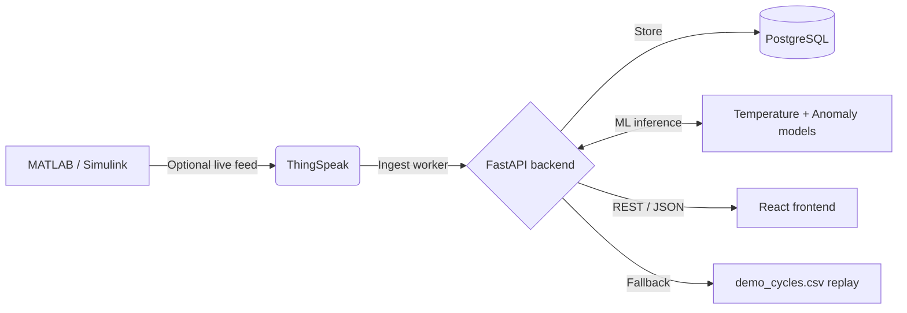

# EV Wireless Power Transfer (WPT) Monitor

A full-stack, real-time telemetry dashboard for wireless power transfer EV charging. The system ingests voltage, current, power, and state-of-charge data from ThingSpeak when configured, runs two production machine-learning models, stores readings in PostgreSQL, and presents the results in a React dashboard.

## Active architecture

The backend uses a three-tier source resolver. It first accepts genuinely new ThingSpeak data, falls back to the recorded `webdev/backend/data/demo_cycles.csv` stream when no live source is configured or available, and preserves the last stored reading when a configured live source has temporarily stopped producing new data. The dashboard indicates freshness and source status without connecting to ThingSpeak directly.

## Machine-learning models

| Model | Type | Input | Dashboard use |
|---|---|---|---|
| Temperature soft-sensor | Physics-constrained gradient boosting (monotonic in current and heat) | Equivalent cell charging current, ambient temperature, and two exponentially filtered I² heat terms (τ = 300 s and 1200 s) | Temperature gauge and over-temperature alerts |
| Anomaly detector | Unsupervised Isolation Forest | Equivalent cell charging current and predicted temperature rise | Anomaly status and alerts |

Both models are trained on **charge** cycles of the NASA Li-ion Battery Aging dataset (CC 1.5 A to 4.2 V, then CV; ambient 4, 24 and 43 °C). Only cycles that start within 3 °C of ambient are used, so the temperature rise comes from charging rather than heat left over from a previous discharge. The temperature model predicts the rise above ambient and is evaluated on batteries held out from training (MAE ≈ 0.58 °C).

Pack readings are mapped to an equivalent NASA cell at the same C-rate: `i_cell = -I_pack × CELL_CAPACITY_AH / PACK_CAPACITY_AH` (Simscape uses negative current for charging). The processed dataset `ml/data/nasa_charge_30s.csv.gz` is committed, so the Render build only trains the models. To rebuild it from the original NASA archive, run `python ml/get_data.py --rebuild` (needs `scipy`), and `python ml/get_data.py --demo` regenerates the pack-scale replay stream from real charge cycles.

## Repository layout

| Path | Purpose |
|---|---|
| `ml/` | Dataset download, feature preparation, model training, and runtime inference |
| `webdev/backend/` | FastAPI service, scheduled ingestion, replay fallback, database models, and alerts |
| `webdev/frontend/` | Vite/React dashboard for telemetry, charts, model information, and architecture |

